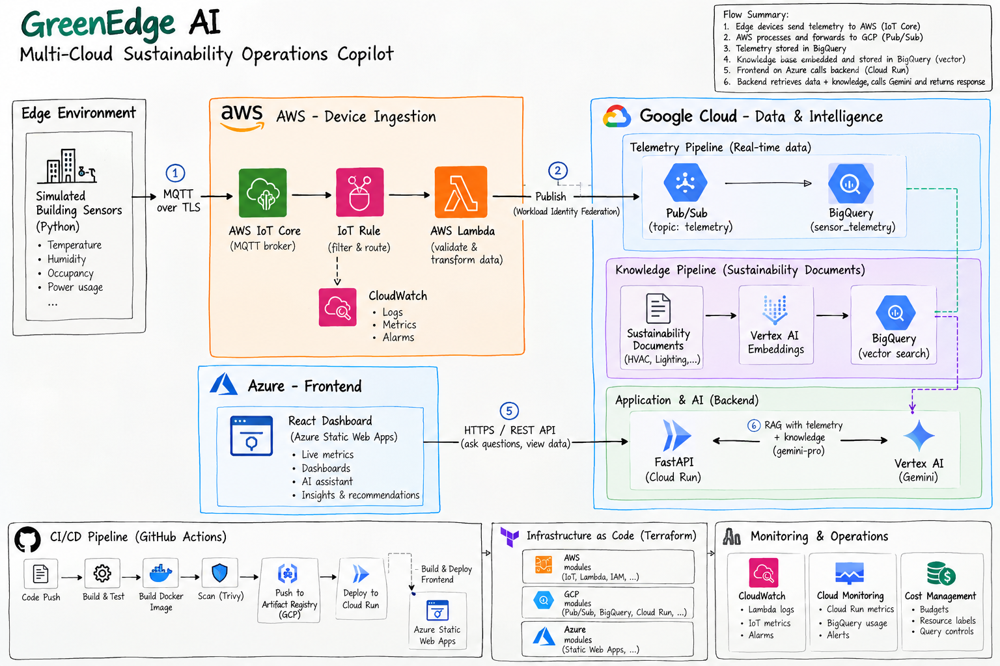
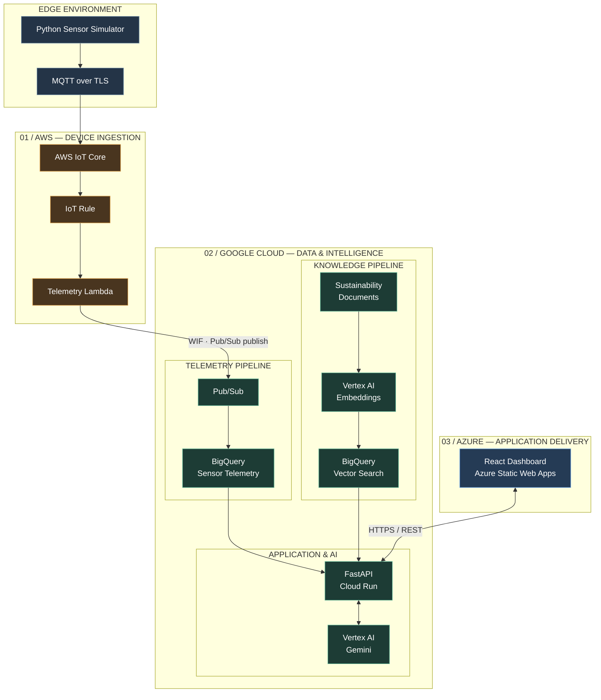
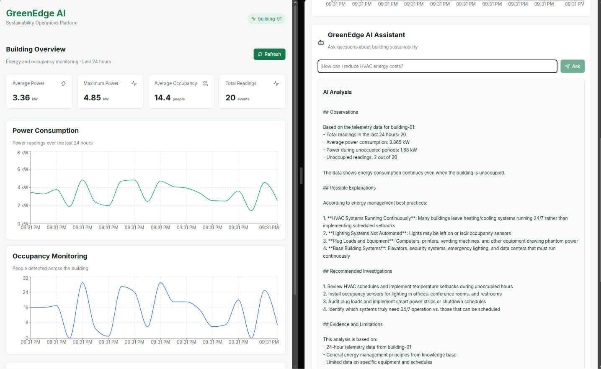

# GreenEdge AI
### A Multi-Cloud Sustainability Operations Copilot

GreenEdge AI is a multi-cloud platform that combines IoT telemetry, cloud analytics, and generative AI to help investigate energy consumption and identify sustainability improvements.

It collects operational data from simulated edge devices, processes it through AWS, analyzes it in Google Cloud, and uses Vertex AI to generate recommendations grounded in actual telemetry and sustainability knowledge.

The goal is simple: move beyond dashboards that only show energy consumption and build a system that helps explain what might be happening and what engineers should investigate.

## Dashboard Preview


## Architecture

GreenEdge AI uses three cloud providers, each responsible for a distinct part of the platform.




| Cloud | Responsibility | Services |
|---|---|---|
| AWS | IoT ingestion and event processing | IoT Core, Lambda, IAM, CloudWatch |
| Google Cloud | Data engineering and AI | Pub/Sub, BigQuery, Vertex AI, Cloud Run, Artifact Registry |
| Azure | Frontend hosting | Static Web Apps |

## How It Works

**1. Edge telemetry**

A Python simulator generates building sensor readings, including temperature, humidity, occupancy, and power consumption. Events are validated and published using MQTT over TLS.

**2. AWS ingestion**

AWS IoT Core authenticates the device and receives telemetry. An IoT Rule invokes Lambda, which validates and forwards events to Google Cloud.

**3. Cross-cloud data pipeline**

Lambda authenticates to Google Cloud through Workload Identity Federation and publishes messages to Pub/Sub. BigQuery stores the incoming telemetry for analytical queries.

**4. Sustainability knowledge and RAG**

Sustainability documents covering HVAC, lighting, and energy management are chunked, embedded using Vertex AI, and stored in BigQuery. Vector search retrieves relevant knowledge for each user question.

**5. AI assistant**

A FastAPI backend combines structured telemetry with retrieved knowledge and passes the evidence to Gemini. The assistant generates recommendations while distinguishing observed measurements from possible explanations.

**6. Frontend**

A React dashboard communicates with the backend through HTTPS APIs, displaying operational metrics, charts, AI responses, and supporting evidence.

## AI Assistant



The assistant is designed to answer questions using operational evidence rather than relying on generic LLM responses.

Example questions:

- Why might energy consumption remain high during unoccupied hours?
- How can HVAC energy consumption be reduced?
- What patterns can be observed in power consumption?
- Which sustainability practices are relevant to the current operating conditions?

The backend retrieves telemetry from BigQuery and relevant knowledge chunks through vector search before invoking Gemini.

It also aims to identify insufficient evidence instead of inventing measurements, energy savings, or causal explanations.

## Engineering and Infrastructure

The project goes beyond application development. Infrastructure, identity, deployment, security, and operational visibility are part of the design.

| Area | Implementation |
|---|---|
| Infrastructure as Code | Terraform modules for AWS, GCP and Azure |
| CI | GitHub Actions, automated tests and linting |
| Containerization | Docker |
| Image security | Trivy vulnerability scanning |
| Backend deployment | Cloud Run |
| Frontend deployment | Azure Static Web Apps |
| Cloud identity | AWS IAM and Google Workload Identity Federation |
| Application metrics | Prometheus-compatible instrumentation |
| Cloud monitoring | AWS CloudWatch and Google Cloud Monitoring |
| Cost management | Billing budgets, resource labels and BigQuery query controls |

GitHub Actions builds commit-specific Docker images, pushes them to Artifact Registry, and deploys the backend to Cloud Run. The frontend is built with its production API URL and deployed to Azure Static Web Apps.

Long-lived cloud service account keys are avoided in automated GCP authentication.

## Technology Stack

`Python` `FastAPI` `React` `Vite` `Docker` `Terraform` `GitHub Actions` `AWS IoT Core` `AWS Lambda` `Google Pub/Sub` `BigQuery` `Vertex AI` `Gemini` `Cloud Run` `Azure Static Web Apps`

## Project Structure

```text
GreenEdge-AI/
├── edge/
│   └── simulator/
├── backend/
│   ├── api/
│   ├── rag/
│   └── telemetry/
├── frontend/
├── analytics/
│   ├── schemas/
│   └── queries/
├── knowledge-base/
│   └── sustainability/
├── infra/
│   ├── environments/
│   └── modules/
│       ├── aws/
│       ├── gcp/
│       └── azure/
├── tests/
├── docs/
│   └── images/
└── .github/
    └── workflows/
```

## Screenshots

The following screenshots can be added as the corresponding implementation components are verified.

| Component | Screenshot |
|---|---|
| AWS IoT ingestion | `docs/images/aws-iot.png` |
| BigQuery telemetry | `docs/images/bigquery.png` |
| RAG knowledge retrieval | `docs/images/rag.png` |
| Terraform infrastructure | `docs/images/terraform.png` |
| GitHub Actions CI/CD | `docs/images/ci-cd.png` |
| Cloud Run deployment | `docs/images/cloud-run.png` |
| Observability dashboard | `docs/images/monitoring.png` |

## Scope and Future Work

GreenEdge AI currently uses simulated sensor data and an initial sustainability knowledge base. Its recommendations are advisory, not autonomous building-control commands.

Future improvements include physical IoT integration, anomaly detection, energy forecasting, retrieval evaluation, authenticated users, and more advanced reliability and cost controls.

---

**GreenEdge AI — From operational telemetry to informed sustainability decisions.**
