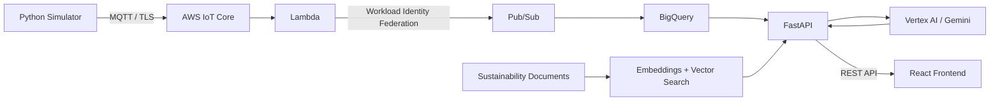

# GreenEdge AI
### Making energy data useful, not just visible.

Most energy dashboards can tell you how much power a building is consuming. That's useful, but it doesn't necessarily tell an engineer what to investigate next.

GreenEdge AI explores a different approach.

It's a multi-cloud sustainability operations platform that takes sensor telemetry, makes it available for analysis, retrieves relevant sustainability knowledge, and uses an AI assistant to help investigate operational inefficiencies.

The interesting part isn't just the AI. It's the infrastructure and data pipeline that make the answers possible.

---

## The system, at a glance


*The application dashboard — replace with a screenshot of the actual running application.*

Three cloud providers, each doing a specific job:

- **AWS** handles device connectivity and incoming telemetry.
- **Google Cloud** handles data ingestion, analytical storage, retrieval and AI.
- **Azure** hosts the user-facing application.

The infrastructure is managed with Terraform rather than being assembled manually through cloud consoles.

## Following a sensor event

A simulated sensor reading travels through the platform before it becomes useful to the AI assistant.



**The journey:**

1. A Python edge simulator generates building telemetry: power, temperature, humidity and occupancy.
2. AWS IoT Core receives the events over MQTT/TLS. An IoT Rule invokes Lambda for processing.
3. Lambda publishes the validated event to Google Cloud Pub/Sub using Workload Identity Federation.
4. Pub/Sub delivers the data to BigQuery, where it can be queried for operational analysis.
5. The FastAPI backend retrieves relevant telemetry and sustainability knowledge.
6. Gemini uses that evidence to formulate an answer, which is returned to the React application.

This separation is deliberate. Telemetry is queried as structured data; sustainability documents are retrieved semantically. The model gets both forms of evidence rather than being asked to guess from a prompt alone.

## Where the engineering gets interesting

### Cross-cloud identity without service account keys

One of the important decisions in this project was avoiding long-lived GCP service account credentials in AWS Lambda and GitHub Actions.

The platform uses Workload Identity Federation to establish trust between external workloads and Google Cloud.

There are two separate identity flows:

- AWS Lambda to Google Cloud for telemetry publishing.
- GitHub Actions to Google Cloud for backend deployment.

Each has its own identity configuration and permissions. This keeps infrastructure provisioning, application deployment and runtime data ingestion from sharing one set of credentials.

### A knowledge base that works alongside live telemetry

The assistant has two sources of context.

**Operational evidence:** readings stored in BigQuery, queried for a particular site and time window.

**Domain knowledge:** sustainability documents covering HVAC efficiency, lighting and energy management. Documents are chunked, embedded using Vertex AI and stored in BigQuery for vector retrieval.

The backend combines the retrieved information before calling Gemini.


*Replace with an actual question and response from the application.*

An important design constraint: an AI-generated explanation is not the same as a measured result. The assistant should distinguish observations from hypotheses, identify missing evidence and avoid inventing energy savings or emissions reductions.

### Infrastructure is part of the application

Terraform manages the cloud resources across the three providers through separate modules and a development environment.

The application is containerized and deployed to Cloud Run. Docker images are stored in Artifact Registry. The React frontend is built and hosted on Azure Static Web Apps.

GitHub Actions handles CI and deployment workflows. The pipelines use commit-specific image tags and federated cloud authentication rather than static GCP service account keys.

Observability and cost controls are also considered: application request metrics, CloudWatch, Cloud Monitoring, billing budgets, BigQuery query limits and resource labels.

## A few implementation details

| Component | Technology |
|---|---|
| Edge simulator | Python |
| Device ingestion | AWS IoT Core, MQTT |
| Event processing | AWS Lambda |
| Cross-cloud messaging | Google Cloud Pub/Sub |
| Analytical storage | BigQuery |
| Semantic retrieval | Vertex AI embeddings, BigQuery vector search |
| AI generation | Gemini |
| Backend | Python, FastAPI |
| Frontend | React, Vite |
| Backend hosting | Cloud Run |
| Frontend hosting | Azure Static Web Apps |
| Infrastructure | Terraform |
| Automation | GitHub Actions |
| Monitoring | Prometheus instrumentation, CloudWatch, Cloud Monitoring |

## Repository layout

```text
.
├── edge/
│   └── simulator/          # Generates and validates sensor events
├── backend/
│   ├── api/                # FastAPI endpoints and AI orchestration
│   ├── rag/                # Retrieval functionality
│   └── telemetry/          # Telemetry processing
├── frontend/               # React dashboard and assistant
├── analytics/
│   ├── schemas/            # Telemetry data contracts
│   └── queries/            # Analytical SQL
├── knowledge-base/
│   └── sustainability/     # Source documents for RAG
├── infra/
│   ├── environments/
│   └── modules/
│       ├── aws/
│       ├── gcp/
│       └── azure/
├── tests/
├── docs/
└── .github/
    └── workflows/
```

## Running it locally

The simulator and application can be developed independently of the cloud deployment.

**Start the backend:**

```bash
uvicorn backend.api.main:app --reload --port 8000
```

**Start the frontend:**

```bash
cd frontend
npm install
npm run dev
```

Configure the frontend's `VITE_API_URL` to point to the backend. The backend also requires the appropriate Google Cloud project, region and application credentials for its BigQuery and Vertex AI integrations.

See the infrastructure environment and application configuration for the deployment-specific settings.

## What this project demonstrates

GreenEdge AI brings together several engineering concerns that are often treated as separate projects:

- Designing an event-driven pipeline across cloud providers.
- Establishing federated identity between independently managed environments.
- Separating analytical queries from semantic retrieval.
- Building an AI workflow that uses retrieved evidence.
- Managing infrastructure through reusable Terraform modules.
- Automating container builds and deployments.
- Considering observability, security and cloud spending alongside application functionality.

The current implementation uses simulated building telemetry and an initial sustainability knowledge base. It is an engineering prototype, not a certified energy-management system. AI recommendations are advisory and do not directly control physical equipment.

---

**GreenEdge AI**

*From a sensor reading to an investigation worth having.*

